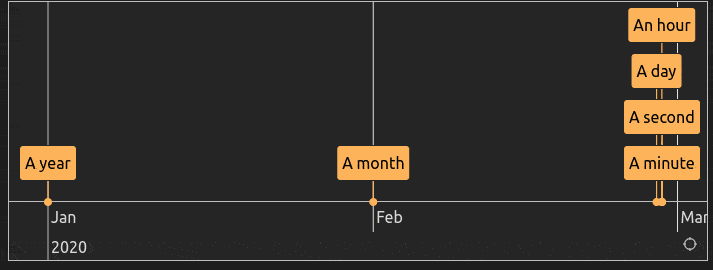

# Chronos Timeline MD

A library for rendering interactive timelines from simple Markdown, anywhere. Make time make sense.

Powered by [vis.js](https://visjs.org/)

**[Complete Syntax Guide](./CHRONOS_SYNTAX_GUIDE.md)**

**[Live Playground](https://clairefro.github.io/chronos-timeline-md/)**

**[Obsidian Plugin](https://obsidian.md/plugins?search=chronos+timeline)**

```
- [2020] A year
- [2020-02] A month
- [2020-02-28] A day
- [2020-02-28T12] An hour
- [2020-02-28T12:30] A minute
- [2020-02-28T12:30:09] A second
```



## Installation

### npm

```sh
npm install chronos-timeline-md
```

```js
import { ChronosTimeline } from "chronos-timeline-md";
```

### CDN (Browser)

```html
<!-- inside <head> -->
<script src="https://unpkg.com/chronos-timeline-md@latest/dist/iife-entry.global.js"></script>
```

## Quick Start

### Method 1: Static Function

```typescript
import { ChronosTimeline } from "chronos-timeline-md";

const markdownSource = `
- [2020] Event 1
- [2021-06-15] Event 2 | Description
@ [2020~2022] Period 1
* [2021-01-01] Point 1
= [2020-12-31] Marker 1
`;

ChronosTimeline.render(
  document.getElementById("timeline-container"),
  markdownSource,
);
```

### Method 2: Constructor API

```typescript
import { ChronosTimeline } from "chronos-timeline-md";

const timeline = new ChronosTimeline({
  container: document.getElementById("timeline-container"),
});

timeline.render(markdownSource);
```

### Browser example (CDN)

```html
<!DOCTYPE html>
<html>
  <head>
    <script src="https://unpkg.com/chronos-timeline-md@latest/dist/iife-entry.global.js"></script>
  </head>
  <body>
    <div id="timeline-container"></div>

    <script>
      const markdownSource = `
- [2020] Event 1
- [2021-06-15] Event 2 | Description
@ [2020~2022] Period 1
* [2021-01-01] Point 1
= [2020-12-31] Marker 1
`;

      ChronosTimeline.render(
        document.getElementById("timeline-container"),
        markdownSource,
      );
    </script>
  </body>
</html>
```

## API Reference

### ChronosTimeline Class

**Static Method:**

```typescript
ChronosTimeline.render(container, source, options?)
```

**Constructor:**

```typescript
new ChronosTimeline({ container, settings?, callbacks?, cssRootClass? })
// or
new ChronosTimeline(container, settings?)
```

**Instance Methods:**

- `render(source: string)` - Parse and render markdown
- `on(event: string, handler: Function)` - Attach timeline events
- `destroy()` - Clean up resources

**Static Properties:**

- `ChronosTimeline.version` - Library version
- `ChronosTimeline.templates` - Built-in templates
- `ChronosTimeline.cheatsheet` - Syntax reference

### Callbacks

Chronos will exposes a small set of optional callbacks that hosts can provide when constructing a timeline instance. Callbacks are passed either via the `callbacks` property on `ChronosTimeline`'s constructor object or via `CoreParseOptions.callbacks` when using the lower-level parse/render functions.

Currently available callbacks:

#### `setTooltip?: (el: Element, text: string) => void`

- Purpose: Allow the host application to take control of how tooltips are displayed. Chronos calls this for timeline items, custom markers, and UI helper buttons (for example the "Fit all" refit button).
- When called: Chronos calls this callback with a target DOM element and the formatted tooltip text whenever a tooltip should be shown.
- Default behaviour: If you don't provide `setTooltip`, Chronos falls back to a simple implementation that sets the element's `title` attribute (so native browser tooltips appear). The default is intentionally minimal so the library remains portable across environments.
- Example (basic):

  ```ts
  const timeline = new ChronosTimeline({
    container: document.getElementById("timeline-container"),
    settings: { selectedLocale: "en" },
    callbacks: {
      setTooltip: (el, text) => {
        // Use a custom tooltip library, or set a data attribute
        // Example using tippy.js:
        tippy(el, { content: text, placement: "top" });
      },
    },
  });
  ```

### Core Functions

```typescript
import {
  parseChronos,
  renderChronos,
  attachChronosStyles,
} from "chronos-timeline-md";

// Parse markdown to timeline data
const result = parseChronos(source, options);

// Render complete timeline
const { timeline, parsed } = renderChronos(container, source, options);

// Inject default styles
attachChronosStyles();
```

## Syntax Highlighting for Developers

Want to add Chronos markdown syntax highlighting to your code editor, IDE, or web application?

**[Syntax Highlighting Implementation Guide](./SYNTAX_HIGHLIGHTING_GUIDE.md)**

### Quick highlight.js Integration

```typescript
import { ui } from "chronos-timeline-md";

// Register Chronos language with highlight.js
ui.registerChronosLanguage(hljs);

// Inject CSS styling
ui.injectChronosHighlightCSS();

// Highlight markdown text
const highlighted = ui.highlightChronosText(markdownSource, hljs);
```

## Chronos Syntax (Quick Reference)

For complete syntax documentation, see **[CHRONOS_SYNTAX_GUIDE.md](./CHRONOS_SYNTAX_GUIDE.md)**

# Basic syntax

```
- [2023] Event
- [2023-06-15] Event with description | Details here
  @ [2020~2025] Background period

* [2023-06-15] Point in time
  = [2023-01-01] Important marker
```

# Note linking

Note linking works for Event (`-`), Point (`*`) and Period (`@`) items. The first `[[wikilink]]` in the content or description becomes the item's link (`cLink`).

```
- [2023] Event [[note]]
* [2023-06-15] Point | [[path/to/note]]
@ [2020~2025] Period | [[note#Heading]]
```

For linked periods the description is stored in `cDescription` (shown in the tooltip) and not appended to the content. Periods without a link still render `content | description` inline.

# With modifiers

```
- [2023] #red Colored event
- [2023] {Group} Grouped event
- [2023] #blue {Authors} Combined | Description
```

# Flags

Can be placed anywhere in your chronos markdown, on its own line

```

> ORDERBY start
> DEFAULTVIEW 2020|2025
> NOTODAY
> NOSTACK
> HEIGHT 400

```

## Configuration Options

```typescript
interface CoreParseOptions {
  selectedLocale?: string;
  roundRanges?: boolean;
  settings?: {
    align?: "left" | "center" | "right";
    clickToUse?: boolean;
    useUtc?: boolean;
    theme?: {
      colorMap?: Record<string, string>;
      cssVariables?: Record<string, string>;
    };
  };
  callbacks?: {
    setTooltip?: (el: Element, text: string) => void;
  };
  cssVars?: Record<string, string>;
  cssRootClass?: string;
}
```

## Examples

### Custom Styling

```typescript
const timeline = new ChronosTimeline({
  container: document.getElementById("timeline"),
  cssVars: {
    "chronos-accent": "#007acc",
    "chronos-bg-primary": "#ffffff",
  },
});
```

### Event Handling

```typescript
const timeline = new ChronosTimeline({
  container: document.getElementById("timeline-container"),
});

timeline.render(markdownSource);

timeline.on("select", (event) => {
  console.log("Selected:", event.items);
});
```

#### Complete List of Timeline Events

**Selection Events:**

- `select` - Items are selected/deselected
- `itemover` - Mouse over an item
- `itemout` - Mouse leaves an item

**Interaction Events:**

- `click` - Mouse click on timeline
- `doubleClick` - Mouse double click
- `contextmenu` - Right-click context menu
- `drop` - Item dropped (drag & drop)

**View Events:**

- `rangechange` - Visible time range changed
- `rangechanged` - Visible time range change completed
- `timechange` - Current time changed
- `timechanged` - Current time change completed

**Group Events:**

- `groupDragover` - Group drag over
- `groupDrop` - Item dropped on group

**Edit Events (if editable):**

- `add` - Item added
- `update` - Item updated
- `remove` - Item removed

**Example Usage:**

```typescript
const timeline = new ChronosTimeline({
  container: document.getElementById("timeline-container"),
});

timeline.render(markdownSource);

// Selection
timeline.on("select", (event) => {
  console.log("Selected items:", event.items);
});

// Hover effects
timeline.on("itemover", (event) => {
  console.log("Hovering over item:", event.item);
});

// View changes
timeline.on("rangechanged", (event) => {
  console.log("New time range:", event.start, "to", event.end);
});

// Click handling
timeline.on("click", (event) => {
  console.log("Clicked at:", event.time);
  console.log("Items at click:", event.item);
});
```

### Templates

```typescript
// Use built-in templates
timeline.render(ChronosTimeline.templates.basic);
timeline.render(ChronosTimeline.templates.advanced);
```

## Theming

### CSS Variables

```css
:root {
  --chronos-bg-primary: var(--background-primary);
  --chronos-text-normal: var(--text-normal);
  --chronos-accent: var(--interactive-accent);
  --chronos-color-red: #ff4444;
  --chronos-color-blue: #0066cc;
}
```

### Dynamic Theme Sync

```typescript
function syncTheme() {
  const root = document.documentElement;
  root.style.setProperty("--chronos-bg-primary", hostThemeColor);
}
```

## Utility Exports

```typescript
// Parser utilities
export * as parser from "chronos-timeline-md/parser";

// UI components and styles
export * as ui from "chronos-timeline-md/ui";

// Common utilities and types
export * as utils from "chronos-timeline-md/utils";
```

## Development

```bash
# Install dependencies
npm install

# Build the package
npm run build

# Development mode with watch
npm run dev

# Run local interactive playground
npm run playground

# Clean build artifacts
npm run clean
```

### Local dev with sym link

If modifying the underlying `chronos-timeline-md` locally and want live changes refelcted:

```sh
# expose local chronos-timeline-md
cd ~/path/to/local/chronos-timeline-md
npm install
npm link
npm run dev # start watch mode
```

```sh
# consume library in plugin
cd ~/path/to/local/obsidian-plugin
npm install
npm link chronos-timeline-md
npm run dev
```

To check which module (npm or local sym link) your plugin is currently using:

```sh
readlink node_modules/chronos-timeline-md

# or

npm ls chronos-timeline-md --depth=0

# if linked, npm often shows an arrow or a path. If installed from the registry it shows the version (e.g., chronos-timeline-md@1.0.8)

```

Unlinking

```sh
npm unlink chronos-timeline-md
# then reinstall from registry
npm install
```

### Publishing to npm

`npm publish` ships whatever is in your **current working folder**.

```bash
# 1. Get onto main with everything merged (merge your PR on GitHub first)
git checkout main
git pull origin main
git status                      # must say "working tree clean"

# 2. Make sure the feature you are releasing is actually here
git log --oneline -5            # your PR's commits should be listed

# 3. Install, test, and build from scratch
npm install
npm test
npm run clean && npm run build

# 4. Preview exactly what will be published
npm pack --dry-run              # must list dist/index.js and dist/index.d.ts

# 5. Bump the version (creates a commit and a git tag; patch | minor | major)
npm version patch

# 6. Publish (the same clean + build runs automatically first)
npm publish

# 7. Push the version commit and tag
git push origin main --follow-tags
```

Rules of thumb:

- **Never publish from a feature branch.** `git branch --show-current` must print `main`.
- **A published version can't be changed or reused.** If something is wrong, fix it and publish the next patch version.
- **Use `npm version`, don't edit the version by hand.** If you did, `git status` will show `package.json` as modified.
- **Version meaning:** `patch` = bug fix, `minor` = new feature, `major` = breaking change.

Verify the release afterwards:

```bash
npm view chronos-timeline-md version                  # shows the new version
npm pack chronos-timeline-md@<version> --dry-run      # should list dist/index.d.ts
```

Then update the consuming plugin, and note that the plugin bundles the library into its own `main.js`, so it needs a rebuild and a new plugin release too:

```bash
cd ~/path/to/obsidian-plugin
npm install chronos-timeline-md@latest
npm ls chronos-timeline-md --depth=0                  # confirm the new version
npm run build
```

## Browser Support

This library requires a modern browser environment with ES2020 support. It includes vis-timeline as a bundled dependency.

## License

ISC
